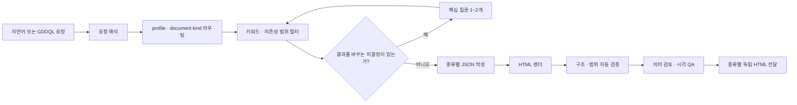

# game-gdd-html

> 게임 아이디어를 문서 종류에 맞게 분리하고, 필요한 범위만 조합해 실무형 HTML 기획서로 만드는 Codex 스킬


[](https://github.com/yang-yun-seok/game-gdd-html/actions/workflows/ci.yml)
[](LICENSE)

`game-gdd-html`은 하나의 거대한 통합 GDD를 무조건 생성하는 도구가 아니다.

사용자가 요청한 **기획서 종류**를 먼저 판별하고, 해당 문서가 책임져야 할 내용만 선택해 독립된 HTML 문서로 작성한다. 자연어를 기본 입력으로 사용하며, 더 정밀한 제어가 필요할 때는 SQL과 비슷한 선택형 문법인 **GDDQL**을 사용할 수 있다.

> **스킬만 설치하려면 [`skill/game-gdd-html/`](skill/game-gdd-html/) 폴더 하나만 복사하면 된다.**
> `.github/`, `docs/`, `tests/`, `tools/`는 저장소 운영과 개발에만 사용하며 설치 대상이 아니다.

---

## 이 스킬이 해결하는 문제

일반적인 AI 기획서 생성은 다음 문제가 발생하기 쉽다.

- 시스템 기획서를 요청했는데 세계관, 마케팅, 일정까지 한 문서에 섞인다.
- 사용자가 필요한 목차를 처음부터 전부 지정해야 한다.
- AI가 입력을 어떻게 해석했는지 설명하는 중간 과정이 본문을 차지한다.
- 기획자가 클래스, API, DB 구조, 서버 아키텍처까지 임의로 결정한다.
- 문서마다 내용과 문체는 비슷하고 제목만 달라진다.
- 프로젝트 브리프, 내부 분류 코드, 생성 메타정보가 결과물에 노출된다.
- 빠진 규칙과 예외를 확인할 검증 기준이 없다.

이 스킬은 문서를 다음 원칙으로 생성한다.

| 원칙 | 동작 |
|---|---|
| 문서 종류 우선 | 요청 시작 단계에서 세부 기획서 종류를 먼저 확정한다. |
| 종류별 독립 출력 | 복수 기획서는 같은 영역이어도 기본적으로 별도 HTML로 생성한다. |
| 키워드 기반 범위 필터 | 종류별 기본 범위에 사용자 키워드와 의존 섹션만 추가한다. |
| 전체 GDD 남용 금지 | `전체`, `통합`, `마스터 GDD`가 명시된 경우에만 전체 문서를 선택한다. |
| 기획 권한 준수 | 무엇을 만들지와 수용조건은 정하지만 구현 방식은 개발 협의로 남긴다. |
| 실무 문체 | 짧은 선언형, 규칙 우선, 표와 상태 중심으로 작성한다. |
| 내부 과정 비노출 | GDDQL, profile, kind, 범위 필터 과정은 최종 본문에 노출하지 않는다. |
| 자동 검증 | 문서 종류, 섹션 범위, 메타데이터, HTML 구조를 스크립트로 검사한다. |

---

## 핵심 기능

### 1. 자연어 요청 해석

사용자는 목차나 필드를 전부 나열할 필요가 없다.

```text
모바일 수집형 RPG의 장비 강화 UI 기획서를 작성해줘.
재료 선택, 일괄 강화, 재화 부족, 성공·실패 결과 상태를 포함하고
강화 확률과 비용 수치는 시스템·밸런스 문서의 결정값을 참조해줘.
```

위 요청에서 스킬은 다음을 구분한다.

- 주 산출물: UI 기획서
- 다룰 범위: 재료 선택, 일괄 행동, 부족 상태, 결과 피드백
- 참조 범위: 강화 확률, 비용, 재료 소모 규칙
- 제외 범위: 강화 수치 확정, 서버 처리 방식, 데이터베이스 구조

### 2. 세부 문서 종류 라우팅

넓은 업무 영역인 `profile`과 실제 산출물 종류인 `document kind`를 분리한다.

예를 들어 `강화 시스템 UI 기획서`는 주제에 `시스템`이 포함되어 있어도 **UI 기획서**로 라우팅한다. 강화 규칙과 확률은 시스템·밸런스 문서의 참조 항목으로 남긴다.

### 3. 1차 범위 필터

선택된 문서의 모든 섹션을 무조건 채우지 않는다.

```text
최종 섹션 = 문서 종류의 핵심 섹션
          + 요청 키워드가 활성화한 섹션
          + 선택 섹션에 필요한 의존 섹션
```

선택되지 않은 다른 영역의 상세 내용은 완성도를 이유로 끼워 넣지 않는다.

### 4. 기획과 구현의 경계

기획 문서는 아래 내용을 확정한다.

- 기획 의도와 적용 범위
- 플레이어 행동과 관찰 가능한 결과
- 상태, 조건, 규칙, 실패와 예외
- UI 표시 원칙과 피드백
- 데이터 항목의 의미와 사용 목적
- 로그로 확인할 행동과 결과
- 완료 조건과 검수 기준

아래 내용은 임의로 확정하지 않는다.

- 클래스와 함수 구조
- API 엔드포인트와 통신 규격
- DB 물리 스키마와 데이터 타입
- 서버·클라이언트 책임 분할
- 프레임워크와 라이브러리 선택
- 알고리즘, 트랜잭션, 멱등 처리 방식
- UUID, 틱레이트, 캐시 전략 등 구현 세부

기술 판단이 필요한 항목은 플레이어 관찰 결과와 기술중립적 품질조건까지만 작성하고 **개발 협의**로 전달한다.

### 5. 실무형 단일 HTML

출력물은 공유와 리뷰가 쉬운 단일 HTML 파일이다.

- 반응형 레이아웃
- 문서 내 목차와 앵커 이동
- 인쇄·PDF 변환을 고려한 스타일
- 필요할 때만 사용하는 Mermaid 다이어그램
- 필요할 때만 사용하는 Chart.js 차트
- 차트와 함께 제공되는 데이터 표
- 문서 종류와 범위를 확인할 수 있는 내부 메타데이터
- 데스크톱·모바일 가독성

Mermaid, Chart.js, Pretendard 웹폰트는 CDN을 사용한다. 네트워크가 없는 환경에서도 본문과 데이터 표는 읽을 수 있지만 외부 라이브러리를 사용하는 시각 요소와 웹폰트는 제한될 수 있다.

---

## 처리 흐름



---

## 지원 문서 종류

총 **9개 카테고리, 41개 세부 문서 종류**를 지원한다.

### 프로젝트 전체 기획

| 문서 종류 | kind |
|---|---|
| 게임 제안서 | `game-proposal` |
| 게임 콘셉트 기획서 | `game-concept` |
| 게임 디자인 문서·GDD | `master-gdd` |
| 개발 일정 기획서 | `development-plan` |

### 시스템 기획

| 문서 종류 | kind |
|---|---|
| 캐릭터 시스템 기획서 | `character-system` |
| 아이템 시스템 기획서 | `item-system` |
| 퀘스트 시스템 기획서 | `quest-system` |
| 업적 시스템 기획서 | `achievement-system` |
| 제작·강화 시스템 기획서 | `crafting-enhancement-system` |
| 매칭 시스템 기획서 | `matchmaking-system` |

### 전투 기획

| 문서 종류 | kind |
|---|---|
| 전투 시스템 기획서 | `combat-system` |
| 스킬 기획서 | `skill-design` |
| 캐릭터 전투 기획서 | `character-combat` |
| 몬스터·보스 기획서 | `monster-boss` |
| 전투 밸런스 기획서 | `combat-balance` |

### 레벨·콘텐츠 기획

| 문서 종류 | kind |
|---|---|
| 레벨 디자인 기획서 | `level-design` |
| 던전 기획서 | `dungeon-design` |
| 스테이지 기획서 | `stage-design` |
| 콘텐츠 기획서 | `content-design` |
| 튜토리얼 기획서 | `tutorial-design` |

### 경제·밸런스 기획

| 문서 종류 | kind |
|---|---|
| 게임 경제 기획서 | `game-economy` |
| 보상 기획서 | `reward-design` |
| 성장 밸런스 기획서 | `progression-balance` |
| 확률형 시스템 기획서 | `random-probability-system` |
| 상점·상품 기획서 | `store-product` |

### UI·UX 기획

| 문서 종류 | kind |
|---|---|
| UI 기획서 | `ui-spec` |
| UX 흐름도 | `ux-flow` |
| 와이어프레임 | `wireframe` |
| 조작 기획서 | `control-scheme` |

### 세계관·스토리 기획

| 문서 종류 | kind |
|---|---|
| 세계관 기획서 | `world-bible` |
| 시나리오 기획서 | `scenario-design` |
| 캐릭터 설정서 | `character-bible` |
| 대사 스크립트 | `dialogue-script` |

### 데이터·기술 협업 기획

| 문서 종류 | kind |
|---|---|
| 데이터 테이블 정의서 | `data-table-spec` |
| 로직·규칙 정의서 | `logic-rule-spec` |
| 로그 기획서 | `logging-spec` |
| 예외사항 정의서 | `exception-spec` |

이 카테고리도 구현 설계 문서가 아니다. 데이터의 의미, 기획 규칙, 관찰할 이벤트, 예외 결과를 정의하며 물리 타입·DB·API·알고리즘은 확정하지 않는다.

### 운영·마케팅 기획

| 문서 종류 | kind |
|---|---|
| 이벤트 기획서 | `event-plan` |
| 라이브 운영 기획서 | `live-ops-plan` |
| 상품 프로모션 기획서 | `product-promotion` |
| 업데이트 명세서 | `update-spec` |

---

## 지원 프로필

세부 kind가 명시되지 않은 넓은 영역 요청은 12개 프로필 중 하나로 처리할 수 있다.

| profile | 사용 범위 |
|---|---|
| `full` | 전체·통합·마스터 GDD가 명시된 경우 |
| `concept` | 게임 방향성, 플레이 경험, 콘셉트와 범위 |
| `system` | 상태, 규칙, 흐름, 예외 중심의 시스템 설계 |
| `content` | 콘텐츠 구조, 루프, 보상, 진행과 제작 기준 |
| `balance` | 성장 곡선, 난이도, 시나리오와 튜닝 기준 |
| `economy` | 재화 획득·소비, 가격, 보상과 상품 연결 |
| `level` | 공간 흐름, 조우, 체크포인트와 난이도 배치 |
| `ui-ux` | 정보 구조, 사용자 흐름, 화면 상태와 상호작용 |
| `narrative` | 세계, 인물, 사건, 대사와 전달 구조 |
| `live-ops` | 시즌, 이벤트, 세그먼트, 반복 운영과 지표 |
| `production` | 마일스톤, 의존성, 리스크, QA와 업데이트 |
| `business` | 사업 목표, 시장 가설, 성과 지표와 의사결정 |

`게임 기획서 만들어줘`처럼 영역이 불명확한 요청은 자동으로 `full` 처리하지 않는다. 결과를 크게 바꾸는 핵심 영역만 짧게 질문한다.

---

## 설치

### 요구 사항

- Codex Desktop 또는 Codex CLI
- Python 3.10 이상
- Git(저장소 clone·업데이트 시)
- HTML을 확인할 최신 브라우저

Python 스크립트는 표준 라이브러리만 사용하므로 별도의 `pip install`이 필요하지 않다.

### 스킬만 설치

설치 대상은 [`skill/game-gdd-html/`](skill/game-gdd-html/) 하나다. 저장소 루트 전체를 Codex 스킬 폴더에 넣지 않는다.

GitHub 화면에서 설치하려면 `Code` → `Download ZIP`으로 받은 뒤, 압축 안의 `skill/game-gdd-html` 폴더만 `~/.codex/skills/game-gdd-html`로 복사한다.

Windows PowerShell:

```powershell
git clone --depth 1 https://github.com/yang-yun-seok/game-gdd-html.git
Copy-Item -Recurse `
  ".\game-gdd-html\skill\game-gdd-html" `
  "$env:USERPROFILE\.codex\skills\game-gdd-html"
```

macOS 또는 Linux:

```bash
git clone --depth 1 https://github.com/yang-yun-seok/game-gdd-html.git
cp -R ./game-gdd-html/skill/game-gdd-html \
  "$HOME/.codex/skills/game-gdd-html"
```

이미 같은 설치 경로가 있다면 덮어쓰기 전에 기존 폴더를 백업한다. 설치 후 새 Codex 작업을 시작하면 `game-gdd-html` 스킬이 검색된다.

### 저장소 개발과 자동 업데이트

수정하거나 최신 변경을 계속 받으려면 저장소를 별도 위치에 clone하고 설치 경로를 스킬 폴더에 연결한다.

Windows PowerShell:

```powershell
git clone https://github.com/yang-yun-seok/game-gdd-html.git
New-Item -ItemType Junction `
  -Path "$env:USERPROFILE\.codex\skills\game-gdd-html" `
  -Target (Resolve-Path ".\game-gdd-html\skill\game-gdd-html")
```

macOS 또는 Linux:

```bash
git clone https://github.com/yang-yun-seok/game-gdd-html.git
ln -s "$(pwd)/game-gdd-html/skill/game-gdd-html" \
  "$HOME/.codex/skills/game-gdd-html"
```

이 방식의 업데이트는 저장소 루트에서 `git pull --ff-only`를 실행하면 된다.

---

## Codex에서 사용하기

자연어로 문서 종류와 게임 아이디어를 요청하면 된다.

### 시스템 기획서

```text
모바일 수집형 RPG의 캐릭터 시스템 기획서를 HTML로 작성해줘.
레벨, 등급, 성장 재료, 승급 조건, 능력치 반영 시점과
재료 부족·최대 레벨·중복 획득 예외를 포함해줘.
구현 방식은 정하지 말고 개발 협의 항목으로 분리해줘.
```

### UI 기획서

```text
장비 강화 UI 기획서를 작성해줘.
장비와 재료 선택, 예상 결과, 비용 부족 상태, 강화 실행,
성공·실패 피드백, 재시도 흐름을 포함해줘.
강화 수치는 시스템 기획서 참조로 남겨줘.
```

### 콘셉트 기획서

```text
폐허가 된 우주 정거장을 탐색하는 1인용 서바이벌 게임의
게임 콘셉트 기획서를 HTML로 작성해줘.
고립감, 제한된 산소, 소리 기반 위험 탐지, 비선형 탐색을 핵심 경험으로 잡아줘.
```

### 복수 문서

```text
길드 가입과 탈퇴 기능을 대상으로
길드 시스템 기획서, UX 흐름도, 예외사항 정의서를 각각 작성해줘.
문서 간 참조 관계는 남기되 하나의 통합본으로 합치지 마.
```

복수 kind는 같은 프로필에 속하더라도 기본적으로 각각의 HTML로 생성된다.

---

## GDDQL

GDDQL은 자연어 요청을 대체해야 하는 필수 문법이 아니다. 반복 작업, 범위 고정, 자동화 입력처럼 선택 결과를 명시적으로 통제할 때 사용한다.

### 기본 문법

```text
DESIGN <AUTO|profile|profile-list>
KIND <AUTO|kind|kind-list>
FROM "<원본·프로젝트·참조 맥락>"
ABOUT "<설계 대상>"
FOR "<독자·사용 목적>"
GOAL "<결정하거나 작성할 결과>"
WITH <포함 패싯 또는 section-id>, ...
WITHOUT <제외 패싯 또는 section-id>, ...
ASSUME <key>="<value>", ...
OUTPUT HTML <SPLIT|MERGE>;
```

### UI 기획서 예시

```text
DESIGN AUTO
KIND ui-spec
FROM "모바일 수집형 RPG"
ABOUT "장비 강화 화면"
FOR "UI 검토 및 개발 협업"
GOAL "재료 선택부터 결과 확인까지 막힘없는 흐름 정의"
WITH flow, result-feedback, exceptions, insufficient-resource, batch-action, mobile-touch
WITHOUT navigation
ASSUME result-animation="2초 이내"
OUTPUT HTML SPLIT;
```

### 복수 문서 예시

```text
DESIGN (system, ui-ux)
KIND (crafting-enhancement-system, ui-spec)
FROM "모바일 수집형 RPG"
ABOUT "장비 강화"
GOAL "강화 규칙과 사용자 화면을 독립 문서로 정의"
WITH exceptions, insufficient-resource, result-feedback, telemetry
OUTPUT HTML SPLIT;
```

직접 작성한 GDDQL에 구문 오류가 있으면 자연어로 임의 재해석하지 않고 수정 가능한 오류를 반환한다.

자세한 계약은 [`skill/game-gdd-html/references/gddql.md`](skill/game-gdd-html/references/gddql.md)를 참고한다.

---

## 스크립트 사용법

### 1. 요청을 압축 작성 계약으로 컴파일

```bash
python skill/game-gdd-html/scripts/compile_context.py \
  --text "장비 강화 UI 기획서를 작성해줘. 재화 부족과 결과 피드백을 포함해줘." \
  --output-dir working
```

명령은 작은 manifest만 출력하고 `working/`에 다음 파일을 만든다.

- `request-context.md`: 선택 문서의 목적·필수 결정·완료 조건·섹션별 최소 계약
- `<번호>-<document>.json`: profile·kind·scope가 고정된 렌더러 입력 골격

기본 작성 경로에서는 이 두 파일만 읽는다. 41종 kind와 12개 profile의 원본 계약은 유지하지만, 선택되지 않은 문서의 계약과 전체 입력 스키마를 모델 컨텍스트에 올리지 않는다. 컴파일 결과가 `needs-clarification`이면 생성된 질문 하나에 답한 뒤 원문과 함께 다시 실행한다.

JSON 골격의 `[작성 필요]`를 실제 내용으로 모두 교체한다. 렌더러는 미교체 표시와 빈 섹션을 오류로 거부하므로 압축 때문에 내용이 빠진 채 결과물이 만들어지는 것을 차단한다.

### 2. 전체 해석 결과 확인

라우팅 디버깅이나 계약 개발 시에만 전체 해석 JSON을 확인한다.

```bash
python skill/game-gdd-html/scripts/interpret_request.py \
  --text "장비 강화 UI 기획서를 작성해줘. 재화 부족과 결과 피드백을 포함해줘." \
  > request-plan.json
```

정규화된 GDDQL만 확인하려면:

```bash
python skill/game-gdd-html/scripts/interpret_request.py \
  --text "퀘스트 시스템 기획서를 작성해줘" \
  --format gddql
```

### 3. 구조화 JSON을 HTML로 렌더

```bash
python skill/game-gdd-html/scripts/render_gdd.py \
  working/project-ui-spec.json \
  -o output/Project_ui-spec_GDD_YYYYMMDD.html
```

입력 JSON 계약은 [`skill/game-gdd-html/references/input-schema.md`](skill/game-gdd-html/references/input-schema.md)를 따른다.

### 4. HTML 검증

```bash
python skill/game-gdd-html/scripts/validate_gdd.py \
  output/Project_ui-spec_GDD_YYYYMMDD.html \
  --profile ui-ux \
  --kind ui-spec \
  --require-scope
```

JSON 형식의 검증 결과가 필요하면 `--json`을 추가한다.

검증기는 다음을 확인한다.

- 예상 profile·kind와 HTML 메타데이터 일치
- 문서 종류의 기본 facet 존재
- 선택 범위와 실제 canonical section 일치
- 다른 프로필의 섹션 혼입 여부
- 필수 구조, 표지, 목차와 접근성 속성
- 차트·다이어그램의 구조적 유효성
- 프로젝트 브리프와 내부 라우팅 문구의 노출 여부

---

## 테스트

```bash
python tools/validate_skill.py skill/game-gdd-html
python tests/test_interpreter.py
python tests/test_context_compiler.py
python tests/test_kinds.py
python tests/test_profiles.py
```

검증 범위:

- 자연어와 GDDQL 해석
- 전체 계약과 압축 작성 계약의 41종 kind·12개 profile 동등성
- 대표 작성 컨텍스트의 80% 이상 크기 절감
- 미작성 표시와 빈 섹션의 렌더 차단
- 한국어 문서명과 별칭 라우팅
- 41개 document kind 계약
- 12개 profile 렌더링
- core, facet, dependency 범위 조합
- 복수 문서 분리
- 종류·프로필 불일치 차단
- 선택되지 않은 섹션 혼입 차단
- 내부 메타정보의 본문 노출 차단

---

## 저장소 구조

```text
game-gdd-html/
├─ .github/
│  ├─ ISSUE_TEMPLATE/             # 버그·기능·문서 종류 제안 양식
│  ├─ workflows/ci.yml            # Python 자동 검증
│  ├─ CONTRIBUTING.md
│  ├─ CODE_OF_CONDUCT.md
│  ├─ SECURITY.md
│  ├─ SUPPORT.md
│  └─ pull_request_template.md
├─ LICENSE
├─ README.md
├─ skill/
│  └─ game-gdd-html/              # 사용자가 설치할 유일한 폴더
│     ├─ SKILL.md
│     ├─ LICENSE
│     ├─ agents/
│     ├─ assets/
│     ├─ references/
│     │  ├─ kinds/                # 9개 문서 카테고리 계약
│     │  └─ profiles/             # 12개 영역별 섹션 계약
│     └─ scripts/                 # 압축 컴파일러·렌더러·검증 런타임
├─ tests/                          # 저장소 회귀 테스트
├─ tools/                          # 저장소 유지보수 도구
└─ docs/
   └─ CHANGELOG.md
```

### 설계상 단일 진실 공급원

- kind 이름, profile 매핑, 기본 facet, 산출물과 핸드오프: `skill/game-gdd-html/scripts/kind_contracts.py`
- profile별 core, facet, dependency와 허용 section: `skill/game-gdd-html/scripts/profile_contracts.py`
- 한국어 요청 라우팅 키워드: `skill/game-gdd-html/scripts/request_rules.py`
- 선택 문서용 압축 작성 계약과 JSON 골격: `skill/game-gdd-html/scripts/compile_context.py`
- HTML 입력 계약: `skill/game-gdd-html/references/input-schema.md`
- 기획과 구현의 경계: `skill/game-gdd-html/references/planning-authority-boundary.md`
- 실무 문체와 비노출 규칙: `skill/game-gdd-html/references/practical-writing-style.md`

문서와 스크립트의 계약이 달라지면 테스트가 실패하도록 구성되어 있다.

---

## 문서 작성 품질 기준

완성 문서는 다음 질문에 답할 수 있어야 한다.

1. 이 문서가 결정하는 범위와 결정하지 않는 범위가 명확한가?
2. 플레이어가 무엇을 입력하고 어떤 결과를 관찰하는가?
3. 성공, 실패, 취소, 재진입과 중단 상태가 정의되어 있는가?
4. 규칙의 전제조건, 처리 결과와 예외가 구분되어 있는가?
5. 필요한 UI 상태와 피드백이 누락되지 않았는가?
6. 데이터 항목이 구현 타입이 아니라 기획 의미로 정의되어 있는가?
7. 로그가 수집 기술이 아니라 확인할 행동과 결과를 설명하는가?
8. 개발·아트·QA가 다음 행동을 시작할 수 있는 완료 조건이 있는가?
9. 근거 없는 수치와 외부 사실을 확정값처럼 사용하지 않았는가?
10. 다른 문서 영역의 세부 내용을 중복 작성하지 않았는가?

---

## 하지 않는 일

- 출시된 게임의 시스템을 조사해 복원하는 역기획
  - 이 경우 `game-reverse-gdd` 사용을 권장한다.
- 시장 데이터와 매출을 웹 리서치해 작성하는 게임 사업 리포트
  - 이 경우 `game-business-report` 사용을 권장한다.
- 게임 클라이언트·서버 코드 구현
- API, DB, 클래스와 알고리즘 설계
- 최종 아트 에셋 제작
- 근거 없는 밸런스 수치 자동 확정
- 모든 요청을 하나의 통합 GDD로 병합

---

## 자주 묻는 질문

### 문서 종류를 정확히 말하지 않아도 되나?

가능하다. 대상, 독자, 결정 목적과 키워드로 적절한 profile과 kind를 추론한다. 다만 결과를 크게 바꾸는 후보가 둘 이상이면 핵심 질문을 1~2개만 한다.

### `게임 기획서 작성해줘`라고 하면 전체 GDD가 생성되나?

아니다. `전체`, `통합`, `마스터 GDD`가 명시되지 않으면 필요한 영역을 확인한다.

### 시스템 기획서에 UI 내용을 같이 넣을 수 있나?

시스템 규칙에 필요한 UI 접점은 포함할 수 있다. 화면 배치와 상세 상호작용처럼 UI 문서가 소유하는 내용은 별도 `UI 기획서`로 연결한다.

### 데이터 테이블 정의서는 DB 스키마까지 정하나?

아니다. 기획 식별자, 필드 의미, 허용값, 기본값, 관계, 운영 검수 기준을 정의한다. 물리 타입, 인덱스, 테이블 분할과 저장 구조는 개발 협의 사항이다.

### HTML을 직접 수정해도 되나?

권장하지 않는다. 구조화 JSON을 수정한 뒤 다시 렌더하고 검증해야 범위 계약과 본문이 일치한다.

### 복수 문서를 하나로 합칠 수 있나?

기본값은 `SPLIT`이다. 같은 profile의 일반 문서를 합칠 수는 있지만, 서로 다른 kind의 계약과 본문은 독립적으로 유지하는 것을 원칙으로 한다.

### 외부 자료 조사가 항상 필요한가?

아니다. 최신 시장 정보, 법률, 플랫폼 정책, 실제 경쟁작 정보처럼 외부 사실이 결과를 바꿀 때만 조사한다. 확인한 사실에는 출처와 확인일을 붙이고 사실·해석·제안을 구분한다.

### 토큰을 줄이면 기획서 내용도 줄어드나?

아니다. 줄이는 대상은 선택되지 않은 문서 종류의 계약, 전체 입력 스키마와 중복 작업 지시다. 선택된 kind의 필수 산출물·제외 범위·완료 조건, profile의 선택 섹션·최소 완료 조건과 시각화 정책은 압축 계약에 그대로 남는다. 41종 kind와 12개 profile 전체를 대상으로 원본 계약과의 동등성 테스트를 실행하며, 미작성 표시나 빈 섹션은 렌더 단계에서 차단한다.

---

## 변경 작업 권장 순서

1. `skill/game-gdd-html/scripts/kind_contracts.py` 또는 `skill/game-gdd-html/scripts/profile_contracts.py`의 계약을 수정한다.
2. 관련 `skill/game-gdd-html/references/kinds/` 또는 `skill/game-gdd-html/references/profiles/` 문서를 맞춘다.
3. 라우팅이 바뀌면 `skill/game-gdd-html/scripts/request_rules.py`를 수정한다.
4. 회귀 테스트를 추가하거나 기존 기대값을 갱신한다.
5. 다섯 검증·테스트 스크립트를 모두 실행한다.
6. 대표 요청을 해석하고 HTML을 렌더·검증한다.
7. 브라우저에서 데스크톱, 모바일과 인쇄 화면을 확인한다.

기능 변경과 문서 계약 변경을 분리하지 않는다. 계약, 구현, 테스트와 참고 문서는 같은 변경에서 함께 갱신한다.

---

## 기여

버그 수정, 신규 문서 종류, 라우팅 개선, HTML 접근성과 문서 개선을 환영한다.

기여 전 다음 문서를 확인한다.

- [기여 가이드](.github/CONTRIBUTING.md)
- [행동강령](.github/CODE_OF_CONDUCT.md)
- [보안 정책](.github/SECURITY.md)
- [지원 안내](.github/SUPPORT.md)
- [변경 이력](docs/CHANGELOG.md)

Issue는 Bug Report, Feature Request와 Document Kind Request 양식을 제공한다. Pull Request는 템플릿의 범위·호환성·검증 체크리스트를 작성해야 하며 Python 3.10·3.12·3.14 환경에서 자동 검증된다.

---

## 라이선스

이 프로젝트는 [MIT License](LICENSE)로 배포된다. 라이선스 조건에 따라 사용, 수정, 배포와 파생 작업이 가능하다.

---

## 현재 상태

- 41개 세부 문서 종류 지원
- 12개 문서 프로필 지원
- 자연어·GDDQL 입력 지원
- 종류별 독립 HTML 출력
- 범위 메타데이터 기반 자동 검증
- Python 표준 라이브러리만 사용
- GitHub Actions 기반 다중 Python 버전 회귀 테스트
- MIT 라이선스와 공개 기여 워크플로

이 저장소는 게임 기획 문서를 “길게 쓰는 것”보다 **올바른 종류의 문서에 필요한 결정만 남기는 것**을 우선한다.
