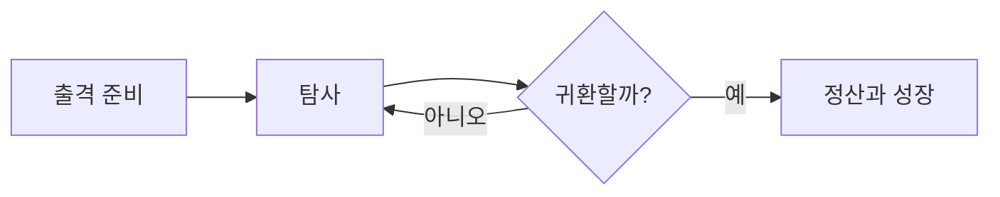

# 시각화 가이드

## 선택 원칙

관계나 순서가 문장보다 명확해질 때만 시각화를 사용한다.
최소 개수와 필수 유형은 선택한 `profiles/<profile>.md`의 계약을 따른다. 다른 프로필의 관례를 맞추기 위해 불필요한 다이어그램이나 차트를 추가하지 않는다.

| 대상 | 권장 표현 |
|---|---|
| 코어 루프, 사용자 흐름 | Mermaid `flowchart LR/TD` |
| 사용자 행동과 게임 상태의 시간 순서 | Mermaid `sequenceDiagram` |
| 상태와 전이 | Mermaid `stateDiagram-v2` |
| 기획 데이터 관계·콘텐츠 의존성 | Mermaid `flowchart LR` |
| 콘텐츠 계층 | Mermaid `mindmap` |
| 성장·난이도 곡선 | Chart.js `line` |
| 항목별 비교 | Chart.js `bar` |
| 다차원 포지셔닝 | Chart.js `radar` |
| 분포 | Chart.js `doughnut` 또는 `pie` |
| 확률·실측 분포 | Chart.js `scatter` 또는 `bar` |
| 규칙, 필드, 예외 | HTML 표 |
| 일정과 단계 | `timeline` 블록 |

## Mermaid 제약

- 한 다이어그램의 노드를 15개 이하로 유지한다.
- Happy Path와 예외 흐름이 복잡하면 분리한다.
- 사용자 행동은 동사로, 시스템 상태는 명사로 쓴다.
- 결정 노드에는 질문형 라벨을 사용한다.
- 선 라벨은 전이 조건 또는 결과를 나타낸다.
- 괄호, 콜론, 슬래시가 포함된 긴 라벨은 따옴표로 감싼다.
- 방향은 사용자 흐름 `TD`, 시스템 구조 `LR`을 기본으로 한다.
- `sequenceDiagram`의 참여자는 플레이어, 화면, 콘텐츠, 게임 상태처럼 기획상 역할로 표현한다. 클라이언트·서버 배치나 내부 호출 순서를 확정하지 않는다.
- 동시 입력은 조건과 기대 결과로 표현하고 프레임·틱 순서를 설계하지 않는다. 정밀 실행 순서가 필요하면 `개발 협의 조건`으로 남긴다.

## Chart.js 제약

- 축과 단위를 명시한다.
- 실제 수치, 목표 수치, 예시 수치를 데이터셋 라벨에서 구분한다.
- 모든 차트에 한 문장의 해석과 출처·가정 캡션을 붙인다.
- 7개를 넘는 범주는 묶거나 표로 바꾼다.
- 원형 차트는 전체가 100%일 때만 사용한다.
- 색상만으로 계열을 구분하지 말고 라벨을 함께 제공한다.
- 장식용 차트를 만들지 않는다.

## 수치가 없을 때

가짜 시계열이나 확률을 만들지 않는다. 다음 중 하나로 대체한다.

- 조정 가능한 변수와 범위를 적은 밸런스 표
- 산식과 변수 정의
- 기대 방향만 보여 주는 검증 계획
- 플레이테스트에서 수집할 이벤트와 성공 기준

## 접근성과 폴백

- Mermaid에는 제목과 캡션을 제공한다.
- Chart.js에는 렌더러가 만드는 데이터 폴백 표를 유지한다.
- 표의 헤더와 단위를 생략하지 않는다.
- 인쇄 시 차트가 잘릴 수 있으므로 차트 앞뒤의 페이지 분할을 확인한다.
